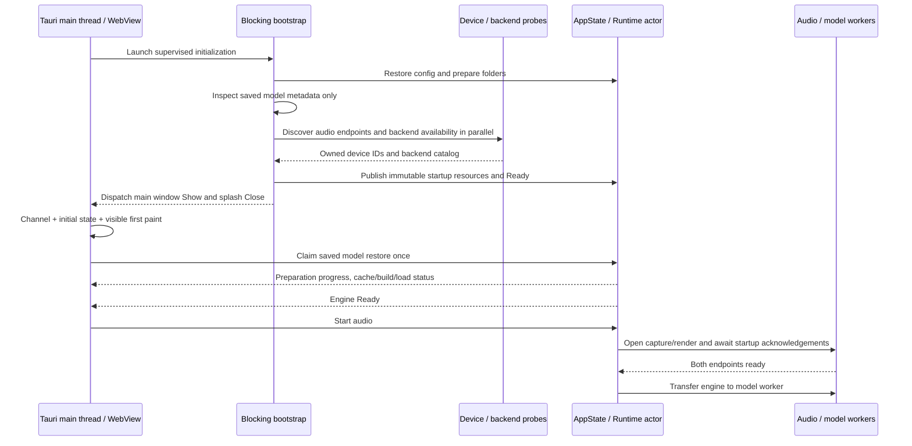

# Windows startup, threads and audio recovery

## Startup order

The splash does not load tensor payloads, compiled plans or inference engines.
Model metadata inspection precedes parallel device discovery; full model loading
starts only after the visible main page has painted. Failed model preparation
does not change shell readiness. A reload or auxiliary window cannot claim a
second automatic restore.

## Thread and synchronization boundaries

| Owner | Work | Synchronization |
| --- | --- | --- |
| Tauri main thread | Window creation, show/hide and native window events | Window operations dispatched to the main thread |
| Async supervisor | Await blocking bootstrap and report task/panic failures | Awaited task result |
| Blocking bootstrap | Config/filesystem setup and bounded model metadata reads | Short startup-state lock; immutable resource catalog |
| `vocal-startup-audio` | Audio device discovery | Scoped thread, owned catalog returned after join |
| `vocal-startup-backends` | GPU/driver/backend availability probe | Scoped thread, owned catalog returned after join |
| Blocking command tasks | Device/file operations and session control | Serialized AppState mutations, Runtime actor commands |
| Runtime actor | Idle engine/model/config ownership | Control channel |
| Capture/render threads | COM audio clients, endpoint buffers and events | Endpoint ownership, SPSC rings and stop event |
| Model worker | Active engine and format converter state | Exclusive engine lease, blocking ring wake/space notifications |
| WebView | Draft settings, rendering and user actions | Tauri Channel, config revisions and preparation operation IDs |

The audio and backend probes do not hold an AppState lock or occupy the Runtime
actor while talking to OS drivers. Startup phases have monotonically increasing
revisions and cannot move backwards. A late task cannot replace ShuttingDown
with Ready or Failed. Boot elapsed time freezes at the terminal result.

The frontend subscribes once, then uses boot events and window visibility
notifications. It rechecks visibility after registering the listener to cover a
Show event racing the initial reply, and cleans up the listener after completion.
There is no startup polling loop. Runtime telemetry retains its separate periodic
refresh outside model preparation.

Closing the main window hides it immediately. Stopping devices and joining the
worker occurs on a blocking task, so a slow model load does not block the native
close button. Capture/render initialization shares one acknowledgement channel:
either endpoint failure signals stop and joins both threads before another
backend can open those endpoints.

## Reported HRESULT and recovery

`0x8889000A` and signed decimal `-2004287478` are the same
`AUDCLNT_E_DEVICE_IN_USE` result. Microsoft defines this as an already occupied
endpoint, including exclusive sessions. It is distinct from an invalid period.
See [InitializeSharedAudioStream return values](https://learn.microsoft.com/en-us/windows/win32/api/audioclient/nf-audioclient-iaudioclient3-initializesharedaudiostream)
and [exclusive-mode ownership](https://learn.microsoft.com/en-us/windows/win32/coreaudio/exclusive-mode-streams).

| Failure | Behavior |
| --- | --- |
| Device busy (`0x8889000A`) | Stop initialization, release this graph, report the device/direction and suggest releasing exclusive access or selecting another device |
| Device invalidated (`0x88890004`) or endpoint missing (`0x80070490`) | Report unavailable device; refresh/reconnect/select another endpoint |
| Access denied (`0x80070005`) | Report permission failure and recovery guidance |
| Audio service stopped (`0x88890010`) | Report service failure |
| Engine period/format locked | Query current shared format/period and retry once on a fresh client, if compatible with the prepared ring format |
| Invalid device period (`0x88890020`) | Retry once with the driver's default period on a fresh client |
| Unsupported format / other initialization error | Permit a reported CPAL fallback after native clients are released |

Busy, missing, invalidated, permission and service failures do not trigger a
second opening attempt through CPAL. CPAL uses the same Windows endpoints and
cannot release another application's exclusive session. The application does
not forcibly close other processes or silently change the selected device.

`WasapiInitError` retains operation, HRESULT, endpoint direction and ID through
both discovery and worker initialization. CPAL errors use their typed error kind
and preserve input/output direction. The GUI receives an actionable message,
recovery suggestions and full technical details, with a shortcut to Audio
routing and a complete JSON copy action.

Device startup errors roll back processing startup without marking the resident
engine Failed. The engine remains Ready, configuration and model stay loaded,
and Start can be retried without reloading weights. Active-session processing
failures continue to use the separate Runtime failure path.

## Verification on 2026-10-07

Windows Debug with TensorRT + DirectML enabled, a saved complete default model
loaded through DirectML, and the Remote Audio output endpoint:

- Shell bootstrap: 1,022 ms; full engine work started after the main page paint.
- DML model restore: 3,789 ms, with workspace preparation progress visible.
- Immutable startup resource query during preparation: 2.1 ms.
- Navigation remained responsive; Start stayed disabled until the engine was Ready.
- Reload sent zero additional restore requests; boot time and preparation ID remained stable.
- Two real audio Start attempts with no capture endpoint produced one typed
  native device-unavailable report each, without a redundant CPAL failure.
- After each failure: engine Ready, audio inactive, model/config unchanged.
  Error details, Audio routing navigation, device controls and dismiss/retry worked.
- Native shared render initialization, negotiated period and IAudioClock passed
  a live endpoint test.
- Checks: 141 workspace tests passed / 9 ignored; audio all-features tests
  42 passed / 4 ignored; Tauri library tests 22 passed; frontend tests 15 passed.
  Frontend production build, workspace all-features check and formatting passed.
  The workspace check emitted an existing incremental-cache access warning.

Generated reports and screenshots are untracked under
`target/windows-build/Debug-TensorRt/`: `workspace-startup-verification.json`,
`audio-start-recovery-verification.json`, `workspace-model-{loading,ready}.png`
and `audio-device-unavailable.png`.

The remote session has no capture endpoint. A physical microphone occupied by
another application, successful full duplex fallback and hardware round-trip
latency could not be measured. Busy classification/no fallback and period
negotiation are covered by focused tests. The opt-in
`live_exclusive_owner_reports_busy_and_release_allows_retry` test requires an
endpoint supporting exclusive PCM16; this Remote Audio endpoint rejected the
exclusive holder initialization with `0x80070006`, so that scenario was not
validated here.
